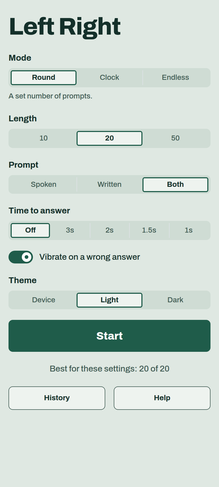
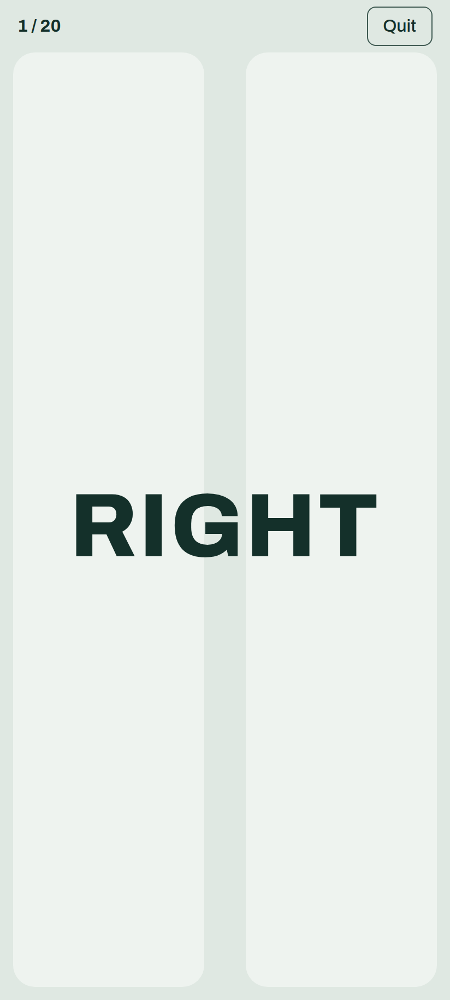
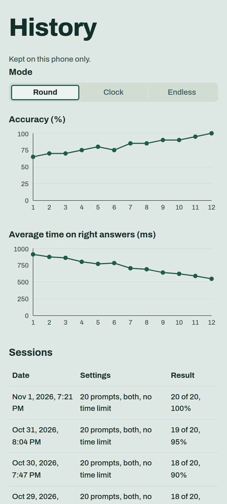

# Left Right

A little phone game for practicing left and right. It says or shows "left" or
"right," and you tap that half of the screen (or press the arrow key) as fast
as you can. It's meant for adults who still have to stop and think about which
side is which.

It's a PWA, so you can add it to your home screen and play it offline.

This app was created entirely by Claude Opus 5.5 at medium effort.

<p>
  
  
  
</p>

# FAQ

## What are the modes?

- **Round:** 10, 20 or 50 prompts, with the same number of each side.
- **Clock:** as many right as you can get in 30, 60 or 120 seconds.
- **Endless:** keep going until you press Stop. Your best is your longest run
  of right answers in a row.

## Where's my history kept?

In `localStorage` on your device, and nowhere else. The only thing that leaves
your phone is a Vercel Analytics page view.

# Setup

1. Install the Node version in `.nvmrc`:
   ```sh
   nvm install
   ```
1. Install dependencies:
   ```sh
   npm install
   ```
1. Run the dev server at http://localhost:3100:
   ```sh
   npm run dev
   ```
1. Build and serve the production version at http://localhost:3101:
   ```sh
   npm run build
   npm run preview
   ```
